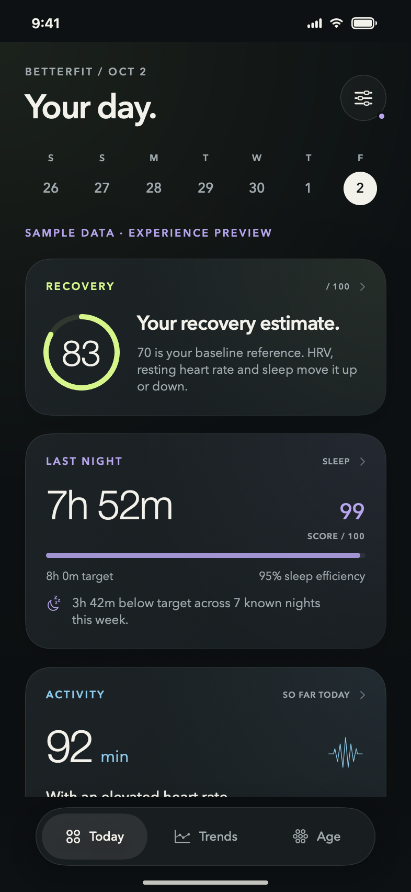
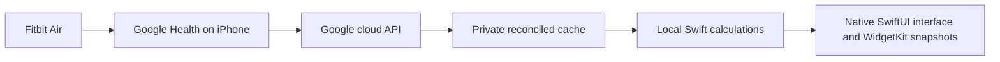

# BetterFit · a personal Fitbit Air app

A native, subscription-free iPhone app built around Recovery, Activity, Sleep and Biological Age. Graphite surfaces, warm ivory typography, distinct metric colors, interactive history and clear calibration states. No LLM, chat, external scoring service or third-party Swift dependency.

Open **`iOS/Form.xcodeproj`**. Both **Form** and the retained **Form Personal** scheme now run the optimized complete app with Home and Lock Screen widgets. App Groups were successfully provisioned with the existing free Personal Team. Technical bundle/client IDs remain unchanged so the update preserves Google sign-in. See [installation and account setup](docs/ios-installation.md).

The prior app is preserved as Git tag **`form-build4-stable`**. [Rollback instructions](docs/betterfit-rollback.md).



## Implemented metrics

| Metric | Calculation | Readiness |
| --- | --- | --- |
| Biological Age — Movement estimate | Published MoveIt! Age: chronological age, maximum daily steps and step variability | Seven consecutive closed days, complete step queries, at least 90% integrated HR coverage each day |
| Recovery | Personal log-HRV/RHR deviations with a sleep deficit term | Seven prior paired nights for a provisional score; 21 for a mature baseline |
| Activity | Observed minutes at ≥50% max HR; higher intensity ≥70%; zone distribution and recording coverage | Live and partial observations labeled; usual-day range and averages use prior finished days with ≥90% HR coverage |
| Earlier Strain scale (detail only) | Existing custom logarithmic 0–21 load scale | Kept for continuity; not WHOOP, a capacity percentage or a danger scale |
| Body signals | HRV, resting HR, overnight SpO₂, breaths/min and absolute skin temperature | Per-signal 10th–90th percentile range from ≥7 prior valid same-source days in 28 days |
| Sleep shortfall and stages | Sum of positive target shortfalls across known completed nights in 7 calendar dates; actual processed Light/Deep/REM | Missing nights/stages stay missing; surplus does not cancel shortfall |
| Sleep | Duration relative to a configurable target, plus sleep efficiency | Valid processed main-sleep summary |
| Sleep regularity | Circular sleep-midpoint deviation from recent history | Seven prior valid nights |

Biological Age is a published movement-derived proxy, not a clinically validated Fitbit Air age measurement. The sample-SD convention and device-transfer uncertainty are explicit. Other scores are versioned app formulas, not WHOOP replicas or clinical measurements. See [model review](docs/research/2026-09-29-age-model-selection.md) and [exact formulas](docs/superpowers/specs/2026-09-29-calculation-engine-design.md).

## Architecture and freshness



The Python harness fetches five scoring streams, reconciles overlapping sources through Google's API, atomically replaces successful windows, preserves cached data on failure, handles corrections/deletions and exports a consistent snapshot. Source selection is Google's wearable family, not proof of a particular device. Credentials and personal records stay in the ignored, owner-only `.private/` directory; no encryption claim is made.

The native iPhone adapter reads eight streams (the five scoring streams plus oxygen, breathing and nightly skin temperature). A compact validated local summary opens before the raw cache finishes loading; a dashboard skeleton covers a first restore. The v2 raw cache seeds from the preserved v1 file without rewriting it.

The iPhone app refreshes on opening/manual refresh, checks at most once per minute while visible, and uses opportunistic background refresh. Initial/weekly sync repairs 32 local dates; normal foreground catch-up requests two physical hours and recent daily summaries. Every 15 minutes it reconciles three local dates. Measurement time and last-check time stay distinct. It cannot fetch readings before Google uploads/processes them or guarantee iOS background execution. See [native sync](docs/native-sync.md) and [authentication](docs/native-auth.md).

## Run the current tools

From the repository root, after Desktop OAuth authorization:

```sh
python3 -m fitbit_audit sync
python3 -m fitbit_audit export --timezone America/Los_Angeles
CLANG_MODULE_CACHE_PATH=.build/clang-cache swift run \
  --disable-sandbox --cache-path .build/cache \
  --scratch-path /private/tmp/fibit-swift-tests \
  metrics-cli .private/google-health/engine-input.json
```

The final command prints private scores; do not paste its output into public logs. Checked-in fixtures are synthetic. `sync` runs once and installs no monitoring. Default sync backfills/repairs 32 local days weekly and otherwise refreshes three recent local dates. `--days 7` requests a bounded manual window. Travel-zone mismatches currently withhold affected scores.

The Swift package targets iOS 17+ and macOS 14+. `FitbitMetrics` owns calculations; `AirSync` owns the private cache/API adapter; `AirAuth` owns PKCE and Keychain; `AirUI` owns presentation and source selection. `form-preview` is a macOS QA host using the same SwiftUI views and explicit synthetic data. It does not connect to an account. See [engine API](docs/engine-api.md).

## Verification and scope

The engine, native sync/auth, UI state, and configuration boundaries have automated regression tests. Native normalization and scoring also match the existing Python account pipeline against a private local fixture. Full Xcode builds cover simulator and physical-iPhone SDK compilation. [Native app validation and remaining device checks](docs/validation/2026-09-29-native-app.md); [engine reference validation](docs/validation/2026-09-29-validation.md).

No subscription or paid inference service is required. Free Apple Personal Team installation requires periodic reprovisioning (currently seven days); shared widgets need an App Group-capable team. No paid Apple membership or distribution service has been purchased or configured. Actual Google iOS consent, physical-device signing and background delivery remain to be verified after account setup. Model attribution and the paper's licensing caveat are in the model review; commercial clearance is not claimed.

## Repository snapshot

This repository starts from the existing app source as of October 16, 2026.
Local development history, account data, signing keys, private diagnostics, and
unrelated projects are excluded. Historical validation notes describe earlier
local runs; local rollback tags and artifacts are not included here.
